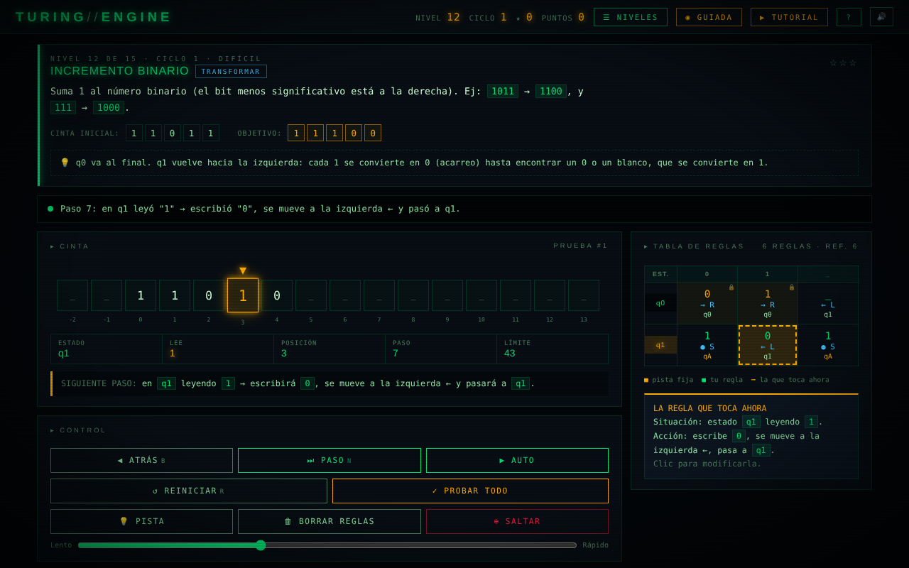

# Turing Engine

Aprende a **programar máquinas de Turing** jugando: una cinta, un cabezal y una tabla de reglas que rellenas tú.
Es **un único archivo HTML**: funciona sin servidor y sin instalar nada, en el ordenador o en el móvil.

### ▶️ [Jugar en el navegador](https://rkarillo-tech.github.io/turing-engine/) · [Descargar el HTML](https://github.com/rkarillo-tech/turing-engine/raw/main/index.html)

> Si lo descargas, guárdalo donde quieras y ábrelo con Chrome, Edge, Firefox o Safari.
> Tu progreso se guarda en el navegador de cada dispositivo.



## Qué incluye

| | |
| --- | --- |
| **Partida guiada** | Juegas el nivel 1 y el juego te resalta en cada momento qué pulsar, avisándote si eliges mal |
| **Tutorial** | 8 diapositivas con la teoría y un ejemplo dibujado paso a paso |
| **15 niveles** | De «escribe unos» a palíndromos y aⁿbⁿ, en dos tipos de reto: transformar la cinta o decidir sí (`qA`) / no (`qR`) |
| **Ciclos infinitos** | Al terminar los 15 niveles empiezan de nuevo con cintas más largas, menos pistas y más puntos |
| **Pruebas** | Cada nivel se comprueba con varias cintas; si una falla, la cargas y la sigues paso a paso |
| **Ayudas** | La regla que toca parpadea en la tabla, paso atrás, traza en castellano y diagrama de estados |
| **Estrellas** | Por superar el nivel, por no pedir pistas y por usar tan pocas reglas como la solución de referencia |
| **Laboratorio** | Modo libre: elige símbolos y estados, edita la cinta e inventa tus máquinas (con ejemplos como el castor afanoso) |

## Cómo se juega

1. Lee el **objetivo** del nivel y mira la cinta inicial.
2. Haz clic en la celda de la **tabla de reglas** que parpadea: es la situación que la máquina necesita resolver ahora.
3. Elige **qué escribe**, **hacia dónde se mueve** y **a qué estado pasa**.
4. Pulsa **⏭ PASO** para verlo funcionar, o **▶ AUTO** para ejecutarlo entero.
5. Cuando la máquina termina bien, se comprueba con todas las cintas del nivel. Si las supera, pasas al siguiente.

Si la máquina se queda sin regla, se detiene: defines la que falta y pulsas **PASO** para continuar desde ese punto.

## Atajos

`N` un paso · `B` paso atrás · `Espacio` auto / pausa · `R` reiniciar · `P` probar todo · `M` niveles · `G` partida guiada · `T` tutorial · `H` ayuda · `Esc` cerrar.
En el editor de reglas: el símbolo para escribir, `←` `↓` `→` para la dirección e `Intro` para confirmar.

## Notas técnicas

- HTML, CSS y JavaScript sin dependencias ni compilación. La cinta es infinita en ambas direcciones.
- Los casos de prueba se generan con una semilla fija por nivel y ciclo, y el límite de pasos se calcula a partir de la solución de referencia.
- Las fuentes Orbitron y Share Tech Mono se cargan de Google Fonts; sin conexión se usa una fuente del sistema.

```
index.html            El juego completo
assets/               Icono (icon.svg y sus PNG, generados con tools/gen_icons.py) y captura
tests/test_juego.py   Pruebas de extremo a extremo con Playwright
```

```bash
python3 -m pip install playwright
python3 -m playwright install chromium
python3 tests/test_juego.py
```

## Licencia

[MIT](LICENSE) © 2026 Rafael Karino Arillo ([rkarillo-tech](https://github.com/rkarillo-tech)).
Puedes usar, copiar, modificar y distribuir el código libremente, manteniendo el aviso de autoría.
Las fuentes Orbitron y Share Tech Mono conservan su licencia SIL Open Font License 1.1.
